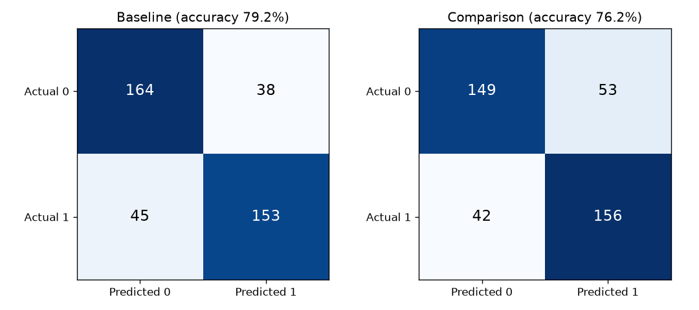
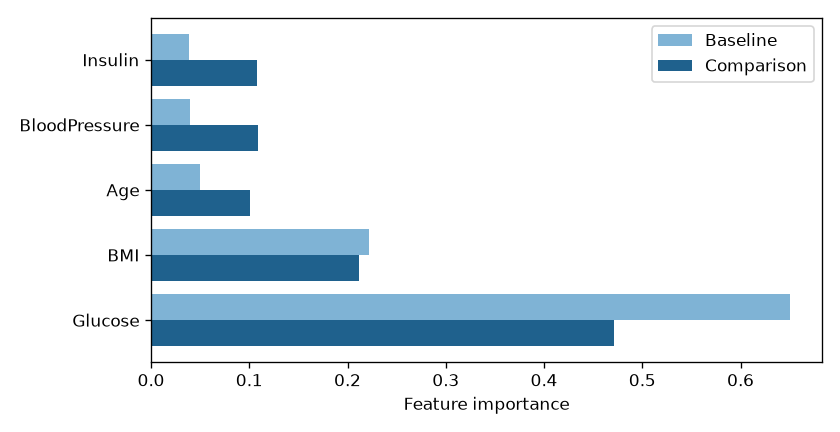
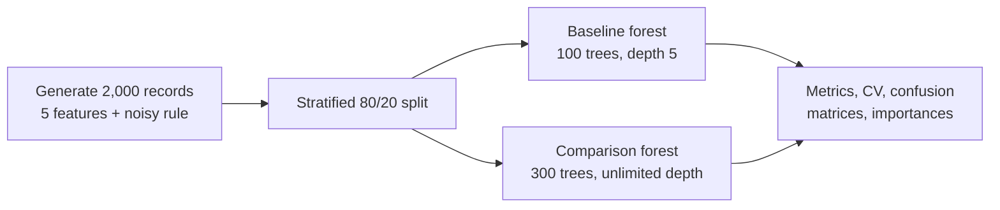

<picture>
  <source media="(prefers-color-scheme: dark)" srcset="assets/banner-dark.svg">
  
</picture>

<p align="center">
  <a href="https://github.com/ashwinpr15/healthcare-diagnostic-hub/actions/workflows/ci.yml"></a>
  
  
  <a href="LICENSE"></a>
</p>

Does a bigger, deeper Random Forest always do better? This small experiment says **no**. On noisy, diabetes-style records, a modest 100-tree forest with depth 5 beats a 300-tree forest with unlimited depth on almost every metric.

## Results

From `python tuning_analysis.py` (2,000 records, stratified 80/20 split, seed 42):

| Metric | Baseline<br><sub>100 trees, depth 5</sub> | Comparison<br><sub>300 trees, no depth limit</sub> |
|---|:---:|:---:|
| Accuracy | **79.2%** | 76.2% |
| Precision | **0.801** | 0.746 |
| Recall | 0.773 | **0.788** |
| F1 | **0.787** | 0.767 |
| ROC AUC | **0.881** | 0.858 |
| 5-fold CV accuracy (training split) | **0.788** | 0.775 |

<p align="center">
  
</p>

### Why the bigger model loses

The label is built from **Glucose, BMI and Age** plus random noise. **Insulin and BloodPressure play no part in it**. Look at what each model relies on:

<p align="center">
  
</p>

The depth-limited forest puts nearly all its weight on Glucose and BMI. The unlimited forest has enough capacity to chase the noise, so it gives real weight to Insulin and BloodPressure even though they carry no signal. That's overfitting you can see, and it's why more trees and more depth aren't automatically better.

## How it works



- **`src/data_gen.py`** creates records shaped like the Pima diabetes dataset: Glucose, BMI, Age, BloodPressure and Insulin. The outcome is 1 when `0.6·Glucose + 1.5·BMI + 0.2·Age` plus Gaussian noise is above the median, so classes are balanced and no model can be perfect.
- **`src/model.py`** holds the two fixed configurations. `train_and_evaluate()` returns test accuracy for both, and `detailed_report()` adds precision, recall, F1, ROC AUC, 5-fold cross-validation, confusion matrices and feature importances.
- **`tuning_analysis.py`** runs everything, prints the comparison as a signed relative change (it can be negative, and here it is: −3.8%), and saves `results/`.

## Run it

```sh
python -m venv .venv
# Windows: .venv\Scripts\activate    macOS/Linux: source .venv/bin/activate
pip install -r requirements.txt
python tuning_analysis.py           # full report and charts
python tuning_analysis.py --quick   # headline accuracy only
python -m unittest -v               # tests
```

Takes a few seconds on a laptop. Tested with Python 3.13 and scikit-learn 1.9.

## Project layout

```
├── src/
│   ├── data_gen.py          # synthetic, diabetes-style records
│   └── model.py             # the two forests and the metrics
├── tuning_analysis.py       # runs the comparison and saves results/
├── test_evaluation.py       # checks the signed change is reported correctly
└── results/                 # metrics.json and charts from the last run
```

## Good to know

- **The data is synthetic.** Feature names borrow from the Pima dataset to make the example concrete, but nothing here is clinical data, and none of this is medical advice or a diagnostic tool.
- **These are two fixed configurations, not a hyperparameter search.** A natural next step is a `GridSearchCV` over depth, leaf size and feature count with cross-validation, then testing once on the held-out split.
- **Other ideas:** run the same comparison on the real Pima Indians Diabetes dataset, add a logistic-regression baseline, and plot calibration curves, which matter more than accuracy for risk scores.

## License

[MIT](LICENSE)
